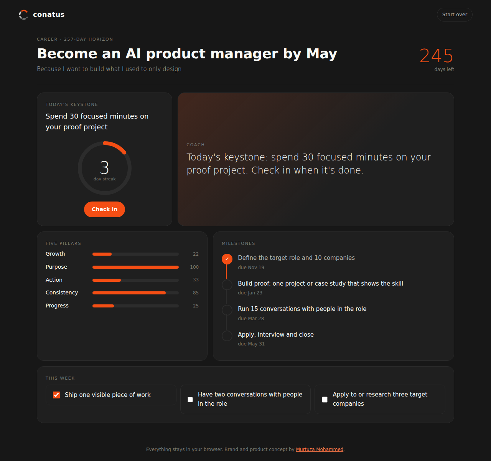
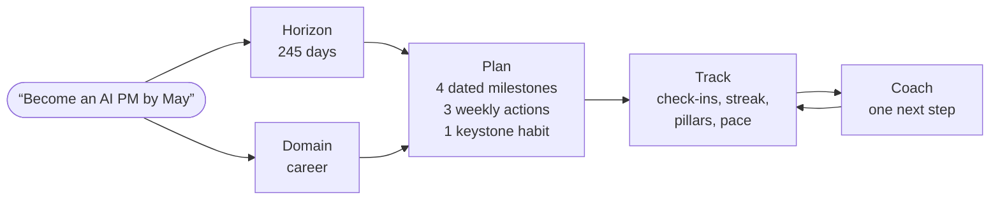
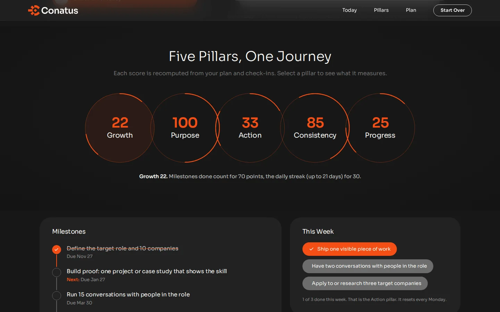
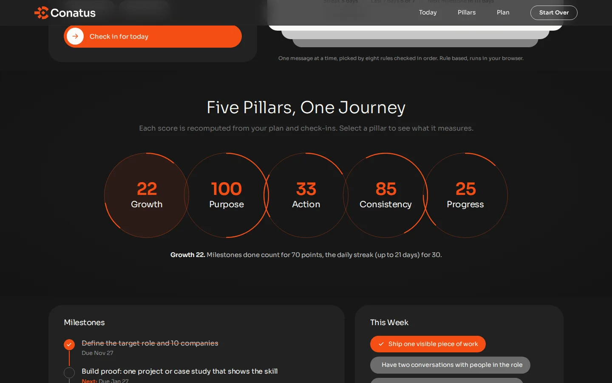
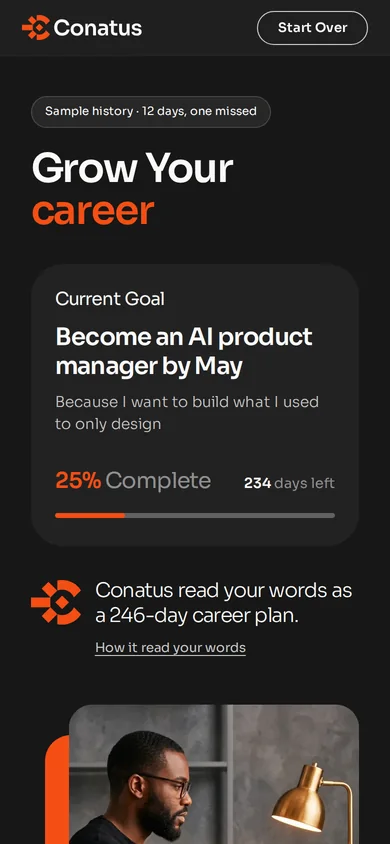
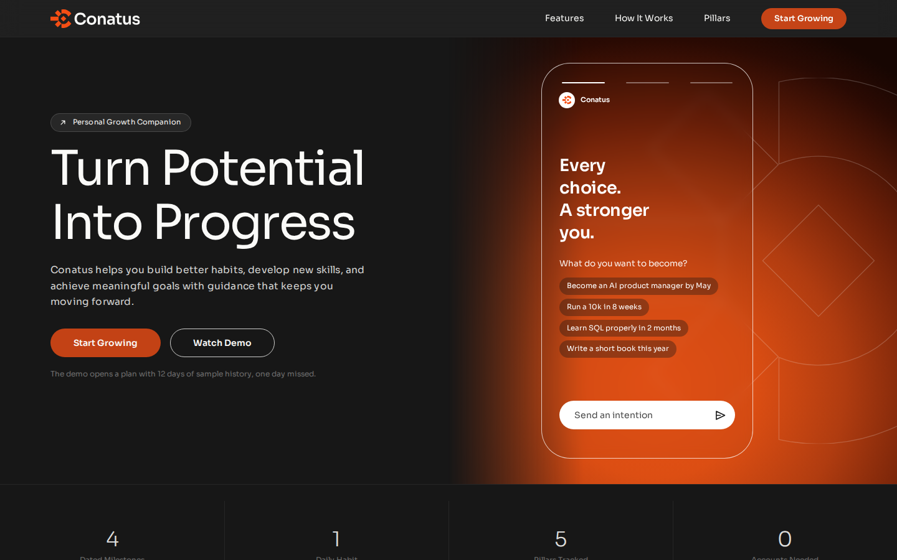

# Conatus

**An AI personal growth companion.** Tell it who you want to become. It turns that intention into a chain: a purpose, four dated milestones, three weekly actions and one daily keystone habit. Then it tracks the chain and coaches the next step.

**[Try it live →](https://murtuzabuilds.github.io/conatus/)** &nbsp;·&nbsp; [Brand identity case study](https://murtuzabuilds.com/#portfolio)



*Conatus* is Spinoza's word for the drive of every being to persist and grow. I first designed Conatus as a brand identity. This repo is the product behind the brand: the same five pillars, working.

## The five pillars

| Pillar | What it measures in the app |
|---|---|
| **Growth** | Milestones completed, plus how long the daily streak has held |
| **Purpose** | Whether you wrote down *why*. A goal without a reason scores half |
| **Action** | Share of this week's actions done |
| **Consistency** | Share of days checked in over the last 14 (or since you started) |
| **Progress** | Milestones done out of four, compared with the time elapsed |

## How it thinks



- **Model** (`src/model.js`): a real model (gpt-oss-120b on Groq, through the same Cloudflare Worker as Umbra and CardRight) writes the words of the plan for your intention: four milestones, three weekly actions and one daily habit. It never sets a date. A checker rejects anything of the wrong shape, health-risk goals always carry a note to involve a professional, and words that suggest someone may be in crisis get a pointer to support instead of a plan, without calling the model at all. If the model is slow or down, the rules planner below takes over and says so.

  **How well it works.** I wrote 30 test goals (24 ordinary, 4 with health risk, 2 crisis messages) and sent all of them to the live model on 13 October 2026. Raw answers are in `eval/results/groq-plans.json`, and a test rescores them so the numbers here cannot drift.

  | | Model | Rules alone |
  |---|---|---|
  | Plans specific to the goal (strict word check) | **23 of 30** | 1 of 30 |
  | Health-risk goals with a care note | 4 of 4 | 4 of 4 |
  | Crisis messages answered with support, no plan | 2 of 2 | 2 of 2 (app guard) |
  | Plan written for "hack my ex's email" | no | n/a |
  | Median response | 0.6 s | instant |

  The specificity check is deliberately strict: a milestone counts only if it reuses a word from the goal. The 7 misses read as on-topic to a person (the SQL plan goes SELECT, joins, GROUP BY, a dashboard on team data), but they fail the rule, and I left the rule as it was written before the run. In that run the model answered the email-hacking request with its crisis flag, which would have shown a support message where a plain refusal fits. Fixed since: requests to harm or intrude on someone else are now caught before any model call and get a plain no, and the model has its own separate refuse answer for anything the app's check misses.
- **Planner** (`src/planner.js`) always sets the calendar. It reads the time horizon ("in 8 weeks", "by May", "this year") and the domain (career, fitness, learning, creative or general), then lays out milestones evenly across the horizon.
- **Tracker** (`src/tracker.js`) computes the streak, consistency and the five pillar scores, plus *pace*: are you ahead of or behind the plan's schedule?
- **Coach** (`src/coach.js`) picks exactly one message from the state, in priority order:

| Situation | What the coach says |
|---|---|
| Two days missed | Restart small: five minutes of the habit today. The chain matters more than the size of the link |
| Milestone due within 3 days | Point this week's actions at it |
| Milestone overdue | Finish it this week or change the plan on purpose. Drifting is the only wrong answer |
| Every 7-day streak | Raise the bar a notch |
| Behind pace | Do the one action that moves the next milestone most, first |

## Design decisions

1. **One keystone habit, not a to-do list.** People keep one daily promise far more reliably than five.
2. **A missed day is expected.** The streak doesn't break on a day you haven't done yet, and the coach answers a gap with a smaller step, not guilt.
3. **Purpose is a pillar.** Writing down why measurably changes follow-through, so the app scores it and prompts for it.
4. **Private by default.** Everything lives in `localStorage`. There's no account and no server.
5. **The model writes, the rules decide.** The model only supplies words. Dates, tracking and coaching stay rule-based, so they are instant and testable, and the app still works when the model is down.

## More screens

| | |
|---|---|
|  |  |
| Five pillars | Milestones and this week |



Dashboard on a phone.

## Run it

```bash
git clone https://github.com/murtuzabuilds/conatus && cd conatus
npm test     # 18 tests, no dependencies
npm start    # serve locally, or just open index.html through any static server
```

On the first screen, "See it with 12 days of history" loads a realistic demo, including one missed day.

## Brand

The app uses the Conatus identity from the brand case study: **Vivid Orange** `#F44E14`, **Charcoal Black** `#171717`, **Warm Off-White** `#FAFAF8`, **Light Grey** `#C7C7C7` and **Medium Grey** `#707070`, set in **Sora**. The logomark is rebuilt as an SVG from its construction grid: a C formed by two arcs around a central diamond, with the forward bar and two diamonds reaching left, momentum out of a steady core. The first screen cycles the campaign lines: *Keep moving. Keep becoming.* · *Every choice. A stronger you.* · *Quiet mind. Clear direction.*



---

Brand, product concept and code by [Murtuza](https://murtuzabuilds.com). MIT licensed.
